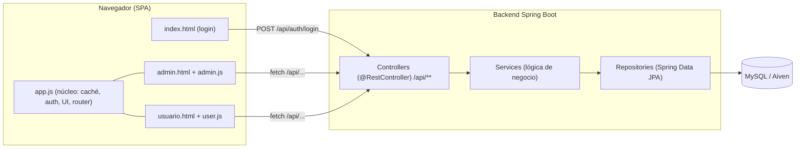

# Arquitectura — PLUSTWENTY (Gestión de Matrículas y Pensiones)

Sistema web para una academia preuniversitaria. Permite **matricular estudiantes**, generar su
**cronograma de pensiones**, y que los estudiantes/apoderados **reporten pagos** (Yape/Plin) que el
administrador **verifica**. Incluye notificaciones, auditoría y un portal separado por rol.

---

## 1. Tecnologías

| Capa | Tecnología |
|------|-----------|
| Backend | **Java 17** + **Spring Boot 3.3.5** (Spring MVC, Spring Data JPA, Spring Security Crypto) |
| Base de datos | **MySQL** (en la nube con **Aiven**); Hibernate con `ddl-auto=update` |
| Frontend | **SPA** (Single Page Application) en HTML + **JavaScript** nativo; **Tailwind CSS**, **SweetAlert2**, **Font Awesome** |
| Build / Deploy | **Maven** (`mvnw`) + **Docker** → desplegado en **Render** |

El frontend es **estático** (se sirve desde el backend) y se comunica con el servidor por una **API REST** con **sesión de servidor** (cookie).

---

## 2. Vista general



**Flujo en una frase:** el navegador (SPA) pide datos y ejecuta acciones por `/api/**`; los
**controllers** validan y delegan en los **services**, que usan los **repositories** para leer/escribir en **MySQL**.

---

## 3. Estructura del proyecto

```
src/main/java/pe/plustwenty/
├── PlustwentyApplication.java        # Arranque de Spring Boot
├── config/
│   ├── AuthInterceptor.java          # Exige sesión iniciada para /api/** (salvo login/bootstrap)
│   ├── WebConfig.java                # Registra el interceptor
│   ├── PasswordConfig.java           # Codificador BCrypt
│   └── SeedRunner.java               # Carga datos de ejemplo si la BD está vacía
├── model/                            # Entidades JPA (tablas)
│   ├── Usuario, Estudiante, Apoderado
│   ├── Matricula, Pension, Pago, ComprobantePago
│   ├── Programa, Ciclo
│   ├── Notificacion, Auditoria
│   ├── Contador                      # Correlativos (recibos, matrículas…)
│   └── Ordenable                     # Clase base con el campo "orden"
├── repository/                       # Interfaces Spring Data JPA (una por entidad)
├── service/                          # Lógica de negocio
│   ├── DataService.java              # Acceso genérico por "colección" + autorización por rol
│   ├── SesionService.java            # Usuario de la sesión actual
│   ├── SeedService.java              # Carga/reinicio de datos demo
│   ├── CounterService.java           # Correlativos atómicos (con bloqueo de fila)
│   ├── PagoRevisionService.java      # Aprobar/rechazar pago (transaccional)
│   ├── MatriculaService.java         # Registrar matrícula + cronograma (transaccional)
│   ├── EventoService.java            # Notificar al estudiante + auditar (compartido, DRY)
│   └── ApiException.java             # Error de negocio con código HTTP
└── web/                              # Controladores REST (@RestController)
    ├── AuthController.java           # /api/auth/login · logout · change-password
    ├── DataController.java           # /api/bootstrap · /api/data/{coleccion} (CRUD genérico)
    ├── NotificacionController.java   # /api/notificaciones: conteo · lista paginada · marcar leídas
    ├── PagoController.java           # /api/pagos/{id}/aprobar · /rechazar
    ├── MatriculaController.java      # /api/matriculas/registrar
    ├── VoucherController.java        # /api/pagos/{id}/comprobante (imagen del voucher)
    ├── CounterController.java        # /api/counters/{nombre}/next
    ├── DemoController.java           # /api/demo/reset (solo local)
    └── GlobalExceptionHandler.java   # Convierte errores en JSON {"message": "..."}

src/main/resources/
├── application.properties            # Configuración (BD por variables de entorno)
├── seed/seed.json                    # Datos de ejemplo (usuarios, cursos, etc.)
└── static/
    ├── index.html                    # Redirige al login del SPA
    └── PLUSTWENTY/
        ├── index.html                # Login
        ├── admin.html / usuario.html # Paneles (admin / estudiante)
        ├── css/styles.css            # Estilos propios
        └── js/
            ├── app.js                # Núcleo compartido (caché, auth, UI, router SPA, APIs)
            ├── admin.js              # Vistas del administrador
            └── user.js               # Vistas del estudiante/apoderado
```

---

## 4. Patrón por capas (backend)

El backend sigue el patrón clásico de Spring en **3 capas**:

1. **Controller (`web/`)** — recibe la petición HTTP, verifica el rol y delega. No tiene lógica de negocio.
2. **Service (`service/`)** — contiene la lógica y las **transacciones** (`@Transactional`).
3. **Repository (`repository/`)** — acceso a datos con Spring Data JPA (sin escribir SQL a mano).

Ejemplo (aprobar un pago):

```
PagoController.aprobar()  →  PagoRevisionService.aprobar()  →  PagoRepository / NotificacionRepository / ...
   (verifica admin)            (todo en 1 transacción)            (guarda en MySQL)
```

---

## 5. Flujo de datos (frontend ↔ backend)

1. **Login** — `POST /api/auth/login` crea una **sesión** (cookie) y redirige a `admin.html` o `usuario.html` según el rol.
2. **Carga inicial** — `app.js` llama `GET /api/bootstrap`, que devuelve **solo lo que el usuario puede ver** (el admin ve todo; el estudiante, solo lo suyo) y el número de notificaciones sin leer. Se guarda en una **caché en memoria**.
3. **Navegación** — el router por *hash* (`#vista`) **re-renderiza desde la caché**; no recarga todo en cada pestaña.
4. **Lectura** — las vistas leen de la caché (`db.all/find/where`).
5. **Escritura** — dos caminos:
   - **Acciones simples** → `POST/PATCH /api/data/{coleccion}` (CRUD genérico con autorización por rol en `DataService`).
   - **Acciones compuestas** → endpoints **transaccionales por recurso** (`/api/pagos/.../aprobar`, `/api/matriculas/registrar`), que hacen varias cosas en **una sola llamada**.
6. **Notificaciones** — el *badge* usa un **conteo** (`/unread-count`) y la bandeja una **lista paginada**; nunca se descargan todas.

---

## 6. Seguridad

- **Sesión de servidor** con cookie `httpOnly` + `sameSite=lax`. `AuthInterceptor` exige sesión válida en `/api/**` (excepto login, logout, bootstrap y reinicio de demo).
- **Contraseñas con BCrypt**. El hash **nunca se envía** al navegador (`@JsonProperty(access = WRITE_ONLY)` en `Usuario.password`).
- **Autorización por rol** en `DataService`: el administrador accede a todo; el estudiante/apoderado, solo a su propio expediente.
- **Credenciales de la base de datos fuera del código**: se inyectan por variables de entorno (`DB_URL`, `DB_USER`, `DB_PASSWORD`). Nunca se versionan.

---

## 7. Base de datos

- **MySQL** gestionada en **Aiven** (nube). Conexión por SSL.
- JPA/Hibernate crea/actualiza las tablas (`ddl-auto=update`).
- **Índices** para rendimiento (evitan recorrer toda la tabla):
  - `notificacion(user_id)` y `(user_id, leida)`
  - `pago(estudiante_id, pension_id)`, `pension(estudiante_id, matricula_id)`, `matricula(estudiante_id)`
  - `auditoria(orden)`
- **Correlativos atómicos** (`CounterService` + tabla `contador`) para números de recibo y códigos de matrícula, con bloqueo de fila para evitar duplicados.

---

## 8. Cómo ejecutarlo

### Local
1. Copia `config/db.properties.example` a `config/db.properties` y pon tu contraseña de MySQL (ese archivo está ignorado por git).
2. `./mvnw spring-boot:run`
3. Abre `http://localhost:8084/` → login con `admin` / `admin123`.

### Despliegue (Render)
1. Servicio web por **Docker** conectado al repositorio.
2. Variables de entorno: `DB_URL`, `DB_USER`, `DB_PASSWORD` (Aiven) y `DEMO_RESET_ENABLED=false`.
3. Render construye el `Dockerfile` (Maven + Java 17) y expone el puerto que inyecta en `PORT`.

---

## 9. Decisiones de diseño y mejoras recientes

- **API REST + SPA** en vez de páginas renderizadas en el servidor: el navegador maneja la interfaz y el servidor solo expone datos y acciones.
- **Controladores por recurso** (`PagoController`, `MatriculaController`, `NotificacionController`) para las acciones importantes, más fáciles de leer y mantener que el acceso genérico `/api/data/{coleccion}`.
- **`EventoService` compartido** para notificar y auditar: evita duplicar ese código en cada acción (principio DRY).
- **Rendimiento:**
  - Las notificaciones ya **no se cargan todas** (el conteo es un `COUNT` indexado; la lista es paginada) — antes, con muchas filas, se saturaba la aplicación.
  - La navegación **no recarga todo** el servidor en cada pestaña.
  - Las acciones compuestas (aprobar pago, registrar matrícula) pasaron de **4–6 llamadas en fila a 1 sola**, transaccional.
